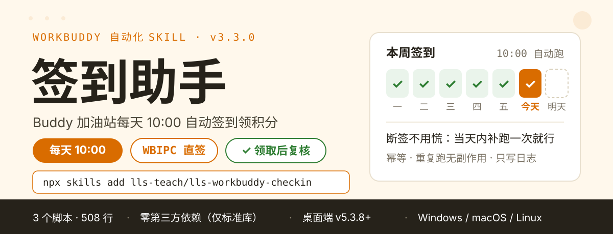

<p align="center">
  
</p>

# lls-workbuddy-checkin · WorkBuddy 签到助手

可安装的 WorkBuddy 自动化 skill：WorkBuddy「Buddy 加油站」每日签到领积分。经客户端自带的宿主通道（WBIPC）直连接口——无需打开界面、无需点击按钮、无需读取或解密本机登录令牌，鉴权头由客户端注入，脚本进程内不接触任何 accessToken，兼容桌面端 v5.3.8+ 的系统级加密登录态。（SKILL.md v3.3.0）

## 安装

```bash
npx skills add lls-teach/lls-workbuddy-checkin
```

- 或 `git clone https://github.com/lls-teach/lls-workbuddy-checkin.git` 后，把整个目录放进对应平台的 skills 目录
- 或在 SkillHub 中添加本仓库（`lls-teach/lls-workbuddy-checkin`）
- 发给你的 AI 助手一句话（复制整段发给它，它会装好、并带你把签到一次跑通）：

  ```
  帮我从 skillhub 里找到这个技能并安装: lls-workbuddy-checkin
  装完后不要停，请按这个技能的搭建流程带我一次走完：先帮我跑通第一次签到，再帮我建好每天 10:00 的自动签到，最后提醒我在微信里建一个每天 10:00 的提醒。
  ```

## 装完之后要做的事

装上只是第一步。下面几步走完，才算真正能每天自动签到（AI 助手会主导全程，你只需要在它喊你时配合一下）：

1. **先跑通第一次签到**：AI 会先自检宿主通道是否连通，再帮你签今天的到，签完还会复核一次确认真签上。成功后去 WorkBuddy 的「Buddy 加油站」看一眼积分到账，就算跑通了。
2. **建好每天 10:00 的自动签到**：AI 会在 WorkBuddy 里建一个每天 10:00 的自动化。以后只要这个时间点你的电脑开着、WorkBuddy 开着，它就自己签到，不用你再操心。
3. **（Windows 可选）开机自启兜底**：重启电脑后自动补签一次，防断签。AI 会先问你，要的话它帮你注册好。
4. **在微信里建一个每天 10:00 的提醒**：AI 会提醒你这一步。提醒内容就是叫你打开电脑——电脑开着，自动化会自己签；电脑没开，这一天就签不了，这条提醒是专门防忘的。

两个前提先说清：① 只支持电脑（Windows / Mac / Linux），手机上用不了，也没有云端版；② 哪天早上没赶上也不用慌，当天内任何时候打开电脑让它跑一次，照样能签上。

## 它是什么

- **一个每天帮你签到的 skill，不是签到脚本合集**：3 个 Python 脚本（共 508 行，仅用标准库，零第三方依赖），由 WorkBuddy 自动化每天 10:00 调度执行。
- **签到结果以 JSON 为准**，关键字段：`status`（ok / error）、`action`（本次新签 `clicked` / 今日已签 `skip_already_signed` / 仅查询 `skip_check_only` / 活动未开启 `inactive` / 复核未通过 `verify_failed`）、`points`（本次领取积分）、`balance`（当前积分余额）、`streak_days`（连续签到天数）、`msg`（人类可读结果）。退出码：`0` 成功或今日已签；`1` 失败。
- **为什么需要这一版**：桌面端 v5.3.8+ 已把本地登录态从明文 JSON 改为系统级加密信封，所有「读明文 token 再直连接口」的旧脚本都会在读取阶段崩掉。本版改走客户端官方宿主通道，鉴权头由客户端注入，从根上绕开令牌问题。

## 为什么不同

| 做法 | 本 skill（v3.3.0） | 旧版（已归档，见文末） |
|---|---|---|
| 鉴权 | 宿主通道 WBIPC，客户端注入鉴权头 | 读本机明文 token |
| 令牌接触 | 脚本进程内不接触任何 accessToken | 需读取本地登录态 |
| 桌面端 v5.3.8+ | 兼容系统级加密登录态 | 读取阶段即崩（典型报错 `slice(None, 6, None)`） |
| 防假成功 | 领取后**再查一次状态复核** | 无复核 |

## 工作原理

1. `workbuddy_ipc.connect()` 连接客户端宿主，取 `wb.request` 管道的 `http.fetch`；
2. 查询签到状态（是否已签、连续天数、累计积分、活动是否开启）；
3. 今日未签则提交领取（幂等：已签同样视为成功）；
4. **领取后再查一次状态复核**，确认真的签上，防止「假成功」；
5. 输出 JSON 结果并写入 `scripts/logs/checkin.log`。

## 快速上手

```bash
python scripts/checkin.py                # 查询 + 必要时领取（推荐，幂等可重复跑）
python scripts/checkin.py --check-only   # 仅查询，不领取
python scripts/checkin.py --diagnose     # 环境自检（模块 / 宿主通道 / 接口连通性）

python scripts/checkin_on_start.py       # 开机/重启后兜底（等待客户端就绪再签到）
python scripts/register_autostart.py --install   # 注册登录自启（Windows 专属）
```

| 脚本 | 作用 | 常用命令 |
|---|---|---|
| `scripts/checkin.py` | 主逻辑：状态查询 + 领取 + 复核 | `python scripts/checkin.py` |
| `scripts/checkin_on_start.py` | 开机兜底：轮询等客户端就绪（默认最长 20 分钟，可调 `WB_START_WAIT_SECONDS`），单实例锁防并发 | 开机后自动跑 |
| `scripts/register_autostart.py` | 管理登录自启项（注册 / 查看 / 注销） | `--install` / `--status` / `--uninstall` |

Windows 上若 `python` 命令不可用，可用 WorkBuddy 自带的托管 Python（位于 `~/.workbuddy/binaries/python/`，版本号以实际安装为准）。

## 什么时候用 / 不用

**用：**

- 每天都开电脑用 WorkBuddy，想把「Buddy 加油站」签到变成不用管的事
- 想确认今天签没签、连续签了几天、积分余额还剩多少
- 重启电脑后怕断签，想要一个开机自动补签的兜底（Windows）

**不用：**

- 只在手机上用 WorkBuddy——本 skill 只支持电脑（Windows / Mac / Linux），没有云端版
- 本机没装 WorkBuddy 桌面客户端，或客户端没登录——签到走的是本机客户端的宿主通道
- 想靠它保证拿到多少积分——签到规则、积分额度与活动周期由官方决定，本技能不保证任何积分收益

## 前提与安全

- 前提：本机已安装并登录 WorkBuddy 桌面客户端（v5.3.8+），开机联网。
- 安全：不读取、不解密、不落盘任何登录令牌；网络访问仅限经宿主通道转发的 WorkBuddy 官方接口；除运行日志外不写任何文件，不上传数据到第三方。
- 适用平台：Windows / macOS / Linux，需 Python 3.6+（仅用标准库，无第三方依赖）；开机自启管理（`register_autostart.py`）为 Windows 专属，写用户级注册表 `HKCU\Software\Microsoft\Windows\CurrentVersion\Run`（值名 `WorkBuddyDailyCheckin`）。

## 目录结构

```
lls-workbuddy-checkin/
├── SKILL.md
├── mcp.json
└── scripts/
    ├── checkin.py               # 主逻辑：状态查询 + 领取 + 复核
    ├── checkin_on_start.py      # 开机/重启后兜底（等待客户端就绪再签到）
    ├── register_autostart.py    # 管理登录自启项（注册/查看/注销）
    └── logs/                    # 运行日志（自动创建）
```

## 自检与反馈

环境自检一键跑（需在 WorkBuddy 客户端环境内运行，沙盒等无客户端的环境会报「无法加载宿主通道模块」，属预期行为）：

```bash
python scripts/checkin.py --diagnose
```

| 现象 | 排查 |
|---|---|
| `无法加载宿主通道模块（workbuddy_ipc）` | 必须在 WorkBuddy 客户端环境内运行；跑 `--diagnose` 看 `module_dir` |
| `宿主通道调用异常` / 连接失败 | 确认 WorkBuddy 客户端已登录且未退出；必要时重启客户端刷新通道 |
| `inactive` | 活动未开启，等下一期活动开始，不是脚本故障 |
| 提示登录态相关错误 | 打开客户端刷新登录即可 |
| 余额显示 null | 接口未返回余额字段，属正常；不影响签到结果 |
| 开机后没签到 | 确认 WorkBuddy 客户端已随开机自启；查 `scripts/logs/start-checkin.log` |

发现 skill 自身的问题，以 `[QC] <一句话问题>` 为标题向本仓库提 issue：https://github.com/lls-teach/lls-workbuddy-checkin/issues

## 版本说明

更早的版本（三通道授权 + 派猫猫旅行 + 多渠道推送）已归档在 tag [`archive/v3.2.1`](https://github.com/lls-teach/lls-workbuddy-checkin/tree/archive/v3.2.1)，可通过 `git checkout archive/v3.2.1` 查看。因桌面端 v5.3.8+ 已将本地登录态改为系统级加密，旧版的读令牌路线不再可用，故自 v3.3.0 起改走宿主通道。

本仓库暂无 LICENSE 文件。

---

## 出品：刘老师

本 skill 由「刘老师（Liu Lao Shi）」（刘洪光，安徽合肥）出品，归属 [lls-teach](https://github.com/lls-teach)，是《WorkBuddy 从零基础到入门》系列课程的配套技能包。

- GitHub 主页：https://github.com/lls-teach —— 刘老师系列课程与技能包都在此，欢迎 star
- 视频号 / 抖音：搜「刘老师讲AI实战」
- 微信：lhgsmsw

觉得有用，欢迎点 ⭐ Star。
